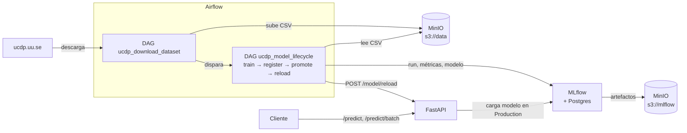

# Clasificador de Severidad de Eventos de Violencia Organizada — UCDP-GED

**MLOps1 — CEIA — FIUBA · Grupo 8**
- Santiago Ruiz
- Maximiliano Antonio Cencic
- Jeraldinne Del Valle Molleda Guanipa

---

## Qué hace y para qué

Dado un evento de violencia organizada del [UCDP Georeferenced Event Dataset (GED) v24.1](https://ucdp.uu.se/downloads/) (país, región, díada de actores, fecha, tipo de violencia, precisión geográfica/temporal), el servicio predice su **severidad**: `Bajo`, `Medio` o `Alto`.

- **Problema:** clasificación multiclase supervisada. El target se obtiene discretizando las muertes estimadas (`best`) con los percentiles 33 y 66.
- **Modelo:** Random Forest (hiperparámetros del trabajo de Aprendizaje de Máquina 1), Macro F1 ≈ 0.57 en test.
- **Qué aporta MLOps:** el ciclo completo (dato → entrenamiento → registro → promoción → servicio) corre de punta a punta y sin pasos manuales, sobre servicios en Docker Compose.

El modelo registrado es un **Pipeline sklearn único** que recibe el evento **crudo** (columnas del UCDP-GED) y aplica internamente target encoding del país, frecuencia de díada, one-hot, features temporales y escalado. La API no precalcula nada.

## Arquitectura



| Servicio | Rol | URL |
|---|---|---|
| Apache Airflow | Orquesta descarga del dato y ciclo de vida del modelo | http://localhost:8080 (airflow / airflow) |
| MLflow | Tracking de experimentos y Model Registry | http://localhost:5001 |
| MinIO | Data lake S3: `s3://data` (dato crudo) y `s3://mlflow` (artefactos) | http://localhost:9001 (minio / minio123) |
| FastAPI | Sirve el modelo en Production | http://localhost:8800 · docs en `/docs` |
| PostgreSQL / Valkey | Metadatos de Airflow y MLflow / broker de Celery | internos |

Estructura relevante:

```
airflow/dags/download_dataset.py        DAG: descarga UCDP-GED -> s3://data/ucdp_ged.csv
airflow/dags/ucdp_model_lifecycle.py    DAG: train -> register -> promote -> reload API
scripts/ucdp_training.py                Entrenamiento (lo invoca el DAG; único camino)
scripts/ucdp_features.py                Feature engineering como transformer sklearn
dockerfiles/fastapi/app.py              API
notebook_UCDP/                          Notebook de análisis y selección del modelo
```

## Cómo reproducirlo

Requisitos: Docker y Docker Compose. En Linux/macOS ajustar `AIRFLOW_UID` en `.env` con tu `id -u`.

1. Levantar todo (incluye la API, que arranca sin modelo y lo toma cuando existe):

   ```bash
   docker compose --profile all up --build
   ```

2. Esperar a que los servicios estén *healthy* (`docker ps`).

3. **No hay que hacer nada más.** `ucdp_download_dataset` corre solo al levantar Airflow (`@once`, sin pausa inicial):
   1. Descarga el UCDP-GED si `s3://data/ucdp_ged.csv` no existe (si ya está, lo saltea).
   2. Dispara `ucdp_model_lifecycle`: entrena, registra `ucdp-severity-rf`, lo promueve a `Production` (archivando la versión anterior) y llama a `POST /model/reload` para que la API sirva la nueva versión sin reiniciar.

   Para reentrenar: disparar `ucdp_model_lifecycle` (o `ucdp_download_dataset`) desde la UI de Airflow.

   > Si hay una versión en Production, la API la carga al arrancar. Antes de que el DAG termine, `/predict` responde `503` y `/health` responde `degraded`.

4. Verificar (ver abajo) y probar la API.

Sin acceso a internet, subir el CSV a mano como `s3://data/ucdp_ged.csv` desde la consola de MinIO; el DAG detecta que existe y no lo descarga.

### Verificar en MLflow

1. Abrir http://localhost:5001 → experimento `ucdp-severity-classification`.
2. La run `rf_optimizado_notebook_params` tiene las métricas `train_f1_macro`, `test_f1_macro`, `train_accuracy`, `test_accuracy`, `overfit_gap_f1`.
3. **Models → `ucdp-severity-rf`**: la versión más reciente está en `Production` y las anteriores en `Archived`.
4. `curl http://localhost:8800/health` devuelve `"status": "ok"` y la misma versión.

## Ejemplos de requests

La API recibe el evento crudo. `best` y `deaths_civilians` son opcionales (si faltan, `civilian_ratio` = 0).

```bash
curl http://localhost:8800/health
curl http://localhost:8800/model/info
curl http://localhost:8800/predict/example      # payload de ejemplo

curl -X POST http://localhost:8800/predict \
  -H "Content-Type: application/json" \
  -d '{
    "country_id": 652,
    "dyad_new_id": 123,
    "date_start": "2015-03-14",
    "latitude": 33.5,
    "longitude": 36.3,
    "region": "Middle East",
    "type_of_violence": 1,
    "where_prec": 1,
    "date_prec": 1,
    "event_clarity": 1,
    "best": 10,
    "deaths_civilians": 5
  }'
# Respuesta: {"severity_code": ..., "severity_label": ..., "probabilities": {"Bajo": ..., "Medio": ..., "Alto": ...}}

# Recarga manual del modelo en Production (el DAG ya lo hace solo)
curl -X POST http://localhost:8800/model/reload
```

Desde Python:

```python
import requests
base = "http://localhost:8800"
payload = requests.get(f"{base}/predict/example").json()
print(requests.post(f"{base}/predict", json=payload).json())
print(requests.post(f"{base}/predict/batch", json=[payload, payload]).json())  # máx. 100
```

Valores válidos: `region` ∈ {Africa, Americas, Asia, Europe, Middle East}; `type_of_violence` ∈ {1, 2, 3}; `where_prec` 1–7; `date_prec` 1–5; `event_clarity` 1–2. Swagger interactivo en http://localhost:8800/docs.

## Apagar los servicios

```bash
docker compose --profile all down                  # detiene
docker compose down --rmi all --volumes            # además borra imágenes, buckets y bases
```

## Configuración

Puertos y credenciales se cambian en `.env`. Las conexiones y variables de Airflow están en `airflow/secrets/`. Para usar MinIO desde tu máquina (boto3, awscli):

```bash
AWS_ACCESS_KEY_ID=minio
AWS_SECRET_ACCESS_KEY=minio123
AWS_ENDPOINT_URL_S3=http://localhost:9000
MLFLOW_S3_ENDPOINT_URL=http://localhost:9000
```

Base del entorno: [amq2-service-ml](https://github.com/facundolucianna/amq2-service-ml) (CEIA, FIUBA), adaptado para este trabajo.
